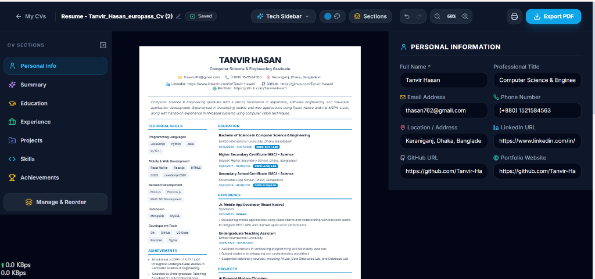
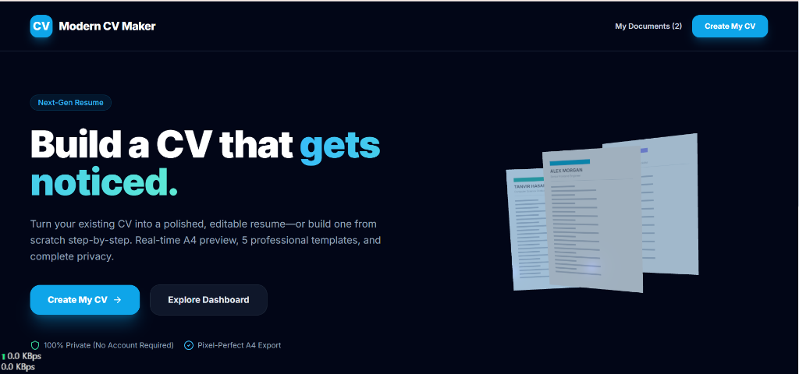
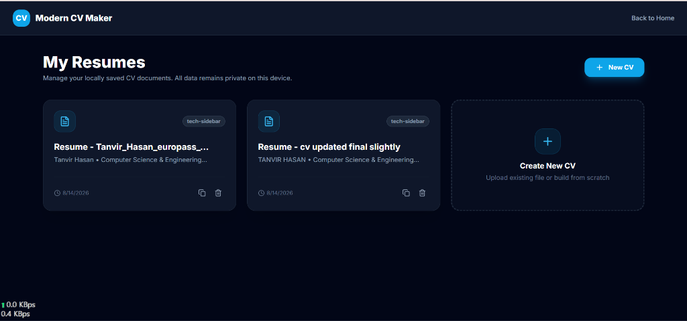

<div align="center">

  # 🚀 AI-Powered Modern CV Maker

  <p align="center">
    <b>Craft ATS-Optimized, High-Impact Resumes in Seconds with AI Intelligence & Real-Time Preview</b>
  </p>

  [](https://nextjs.org/)
  [](https://www.typescriptlang.org/)
  [](https://tailwindcss.com/)
  [](https://dexie.org/)
  [](https://ai.google.dev/)
  [](LICENSE)

  <br />

  <a href="#-screenshots">Screenshots</a> •
  <a href="#-key-features">Key Features</a> •
  <a href="#-tech-stack">Tech Stack</a> •
  <a href="#-architecture">Architecture</a> •
  <a href="#-quick-start">Quick Start</a> •
  <a href="#-roadmap">Roadmap</a>

  <br /><br />
  

</div>

---

## 🌟 Overview

**AI-Powered Modern CV Maker** is a state-of-the-art, open-source resume building platform engineered for speed, privacy, and visual elegance. Built with **Next.js 14 App Router**, **TypeScript**, and **Tailwind CSS**, it empowers job seekers to generate ATS-friendly, professional CVs tailored to industry standards.

Whether importing an existing PDF/DOCX resume or building from scratch, our hybrid **Gemini AI + Rule-Based Parsing Engine** extracts structured professional data seamlessly into customizable, exportable templates.

---

## 📸 Screenshots Showcase

<div align="center">

  ### 🏠 Landing Page
  

  ### ⚡ Dual-Pane Live Editor & Real-Time Preview
  

  ### 📊 Local CV Management Dashboard
  

</div>

---

## ✨ Key Features

| Feature | Description |
| :--- | :--- |
| 🤖 **AI Resume Parsing** | Upload existing **PDF** or **DOCX** files and let Google Gemini AI parse skills, experience, education, and projects instantly. |
| ⚡ **Hybrid Extraction Fallback** | Robust rule-based client-side fallback (PDF.js + Mammoth.js) ensuring 100% extraction uptime even offline. |
| 🎨 **5+ ATS Templates** | Choose between **Classic**, **Executive**, **Modern**, **Creative**, and **Tech Sidebar** templates tailored for corporate & tech roles. |
| 🔄 **Granular Reordering** | Custom drag-and-drop section reordering alongside item-level reordering (move up/down) and quick duplication. |
| 🛡️ **Privacy-First Storage** | 100% client-side persistence using **Dexie.js (IndexedDB)**. Your personal data stays strictly on your device. |
| 📄 **High-DPI PDF Export** | Generate crisp, print-ready, pixel-perfect PDFs powered by an in-browser **jsPDF + html2canvas** rendering pipeline. |
| 🌗 **Dark Mode Editor** | Sleek dark UI with dual-pane layout: real-time live preview on the left and form control panel on the right. |

---

## 🛠️ Tech Stack & Architecture

### **Core Stack**
- **Framework:** [Next.js 14 (App Router)](https://nextjs.org/)
- **Language:** [TypeScript 5.6](https://www.typescriptlang.org/)
- **Styling:** [Tailwind CSS 3.4](https://tailwindcss.com/)
- **Icons & Motion:** [Lucide React](https://lucide.dev/) & [Framer Motion](https://www.framer.com/motion/)

### **AI & Document Processing**
- **AI Parser:** Google Gemini Flash / Pro (`@google/generative-ai`)
- **Document Extractors:** `pdfjs-dist` (PDF Parsing) & `mammoth` (Word DOCX Parsing)
- **PDF Exporter:** `jspdf` & `html2canvas`

### **Storage & State**
- **Local DB:** `dexie` & `dexie-react-hooks` (IndexedDB Wrapper)
- **Validation:** `zod` schema enforcement

---

## 📁 Repository Structure

```gcode
CV-maker/
├── 📁 src/
│   ├── 📁 app/                 # Next.js App Router routes & layout
│   ├── 📁 components/
│   │   ├── 📁 dashboard/       # Saved CV management & dashboard views
│   │   ├── 📁 editor/          # Real-time form control panels & section ordering
│   │   ├── 📁 preview/         # Canvas renderer & template container
│   │   ├── 📁 templates/       # Classic, Executive, Modern, Creative, Tech Sidebar
│   │   └── 📁 upload/          # PDF/DOCX drag-and-drop parser modal
│   ├── 📁 services/
│   │   ├── 📁 export/          # PDF Canvas export engine
│   │   ├── 📁 extraction/      # Gemini AI & Rule-based document parsing
│   │   └── 📁 storage/         # Dexie.js IndexedDB persistence layer
│   └── 📁 types/               # TypeScript data models (cv.ts, storage.ts)
├── 📄 next.config.mjs
├── 📄 tailwind.config.js
└── 📄 package.json
```

---

## ⚡ Quick Start

Follow these steps to set up the project locally on your machine:

### **Prerequisites**
- **Node.js** v18.0.0 or higher
- **npm** or **yarn** / **pnpm** / **bun**

### **1. Clone Repository**
```bash
git clone https://github.com/Tanvir-Hasan1/CV-maker.git
cd CV-maker
```

### **2. Install Dependencies**
```bash
npm install
```

### **3. Set Up Environment Variables**
Create a `.env.local` file in the root directory:
```env
NEXT_PUBLIC_GEMINI_API_KEY=your_google_gemini_api_key_here
```

> 💡 *Note: The app will automatically fallback to the local rule-based parser if no API key is provided!*

### **4. Launch Development Server**
```bash
npm run dev
```
Open [http://localhost:3000](http://localhost:3000) in your browser to view the application.

---

## 🛠️ Environment Variables

| Variable | Required | Description |
| :--- | :--- | :--- |
| `NEXT_PUBLIC_GEMINI_API_KEY` | Optional | Google Gemini API key for intelligent resume parsing. |

---

## 🗺️ Roadmap & Upcoming Features

- [x] Full AI & Rule-Based Resume Parsing (PDF/DOCX)
- [x] Item-level reordering & duplicate functions across Experience & Projects
- [x] 5+ ATS-Optimized Responsive Templates
- [ ] AI Summary & Bullet Point Rewriter (Grammar & Tone Booster)
- [ ] Target Job Description Matching & Keyword Scoring
- [ ] Multi-language translation support (ES, FR, DE, BN)

---

## 🤝 Contributing

Contributions, issues, and feature requests are welcome! Feel free to check the [issues page](https://github.com/Tanvir-Hasan1/CV-maker/issues).

1. Fork the Project
2. Create your Feature Branch (`git checkout -b feature/AmazingFeature`)
3. Commit your Changes (`git commit -m 'Add some AmazingFeature'`)
4. Push to the Branch (`git push origin feature/AmazingFeature`)
5. Open a Pull Request

---

## 📄 License

Distributed under the MIT License. See `LICENSE` for more information.

<div align="center">
  <br />
  Made with ❤️ by <a href="https://github.com/Tanvir-Hasan1">Tanvir Hasan</a>
</div>

